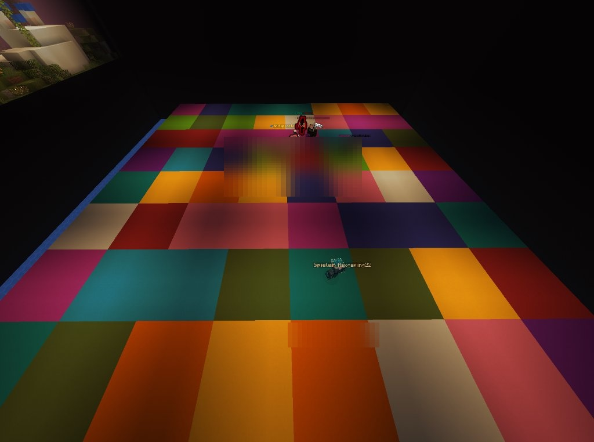
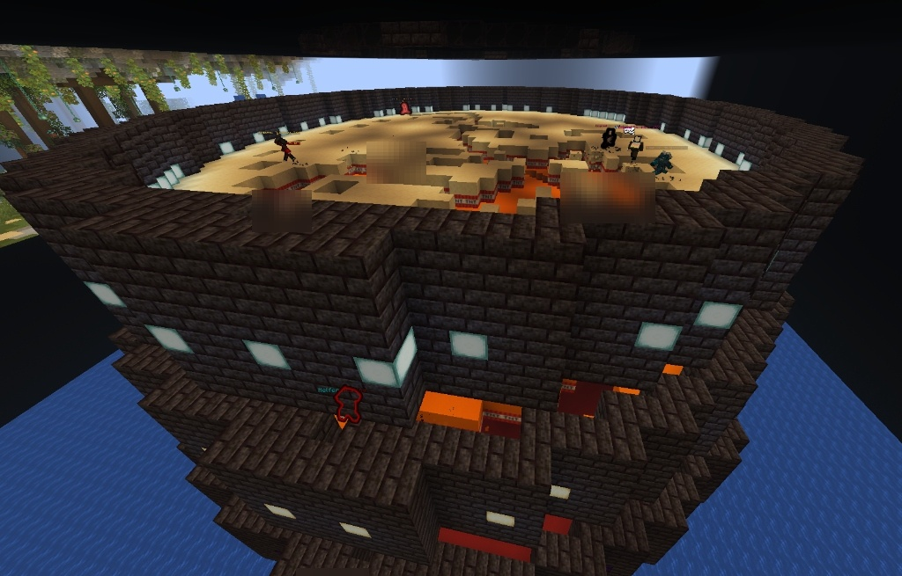
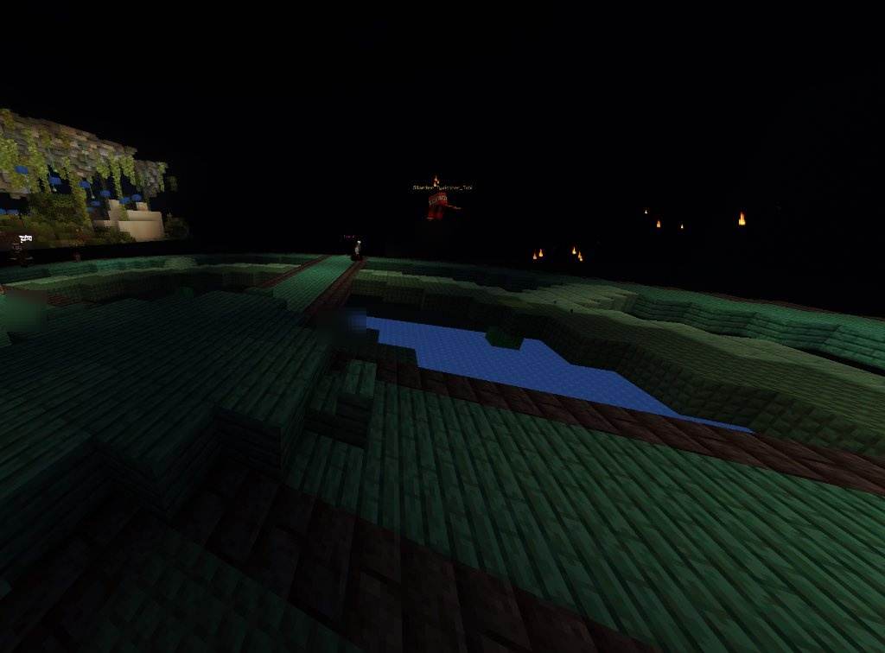
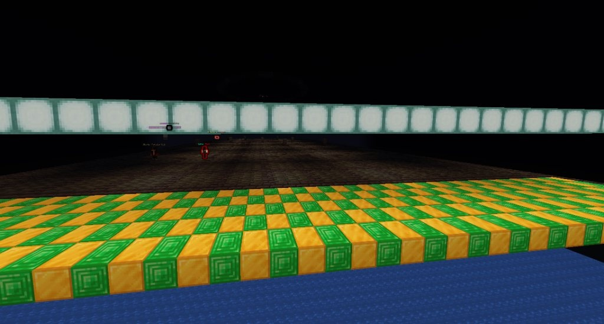
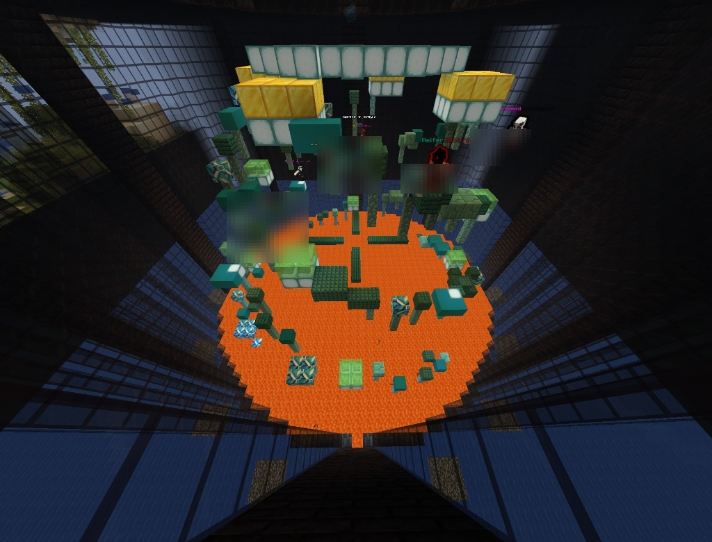

# Mini-Games & Game Rules

UltraEvents features 15+ built-in, highly optimized mini-games designed to test speed, parkour, reaction, and PvP skills.

---

## 🏃 Movement & Agility

### 1. Color Floor `[Lite & PRO]`
* **Objective**: Stand on the announced target color before time runs out!
* **Mechanics**: The arena floor turns into a vibrant mosaic of colored concrete blocks. When a color is called, all other blocks vanish, dropping players who were too slow into the void.

---

### 2. TNT Run `[Lite & PRO]`
* **Objective**: Never stop sprinting!
* **Mechanics**: Every floor block stepped on by a player disappears after a short delay. The last player standing on the platform wins.

---

### 3. TNT Tag `[Lite & PRO]`
* **Objective**: Pass the exploding TNT to another player before the countdown hits 0!
* **Mechanics**: One or more players receive exploding TNT on their head. Punching another player passes the TNT. When the countdown ends, whoever holds the TNT is eliminated!

---

### 4. Red Light, Green Light `[Lite & PRO]`
* **Objective**: Cross the finish line without being spotted moving during Red Light!
* **Mechanics**: During Green Light, rush forward. When Red Light triggers, freeze immediately. Any movement or head turn causes instant elimination!

---

### 5. Laser Sweep `[PRO Only]`
* **Objective**: Jump over rotating laser hazard beams!
* **Mechanics**: Multi-beam laser obstacles spin across the arena, accelerating over time. If a laser touches you, you are swept off the platform!

---

### 6. Parkour Masters `[PRO Only]`
* **Objective**: Complete challenging parkour checkpoints with increasing difficulty and jump precision.

---

## ⚔️ PvP & Combat

### 7. One in the Chamber `[PRO Only]`
* **Objective**: Score the highest kills!
* **Mechanics**: You receive a bow and exactly 1 arrow that kills instantly. Each kill rewards you with another arrow. Miss, and you must rely on melee combat!

### 8. Sumo & Knockback Sumo `[PRO Only]`
* **Objective**: Push opponents off the platform ring!
* **Mechanics**: Fast-paced knockback action where players use fists or specialized knockback rods to knock rivals into the void.

### 9. King of the Hill `[PRO Only]`
* **Objective**: Capture and hold the central beacon zone!
* **Mechanics**: The longer you remain uncontested inside the capture area, the more points you accumulate. As the round progresses, the arena shrinks!

---

## 🔥 Hazard & Survival

### 10. Rising Lava `[PRO Only]`
* **Objective**: The floor is lava!
* **Mechanics**: Molten lava continuously rises from below. Climb upward using shifting terrain before the inferno catches up with you.

---

### 11. Meteor Storm `[PRO Only]`
* **Objective**: Dodge falling explosive meteors!
* **Mechanics**: Fireballs and explosive debris rain from the sky, destroying arena blocks and testing player dodging skills.

### 12. Glass Bridge `[PRO Only]`
* **Objective**: Cross the treacherous glass bridge!
* **Mechanics**: Step onto safe tempered glass panes while avoiding fragile panes that instantly shatter beneath your feet.

### 13. Moving Walls `[PRO Only]`
* **Objective**: Dodge sliding brick walls sweeping across the arena at variable speeds and heights.

### 14. Jump Rope Bridge `[PRO Only]`
* **Objective**: Time your jump intervals across a rotating rope hazard while advancing forward.

### 15. Super Spleef `[PRO Only]`
* **Objective**: Dig snow beneath your opponents to send them falling into the void.
